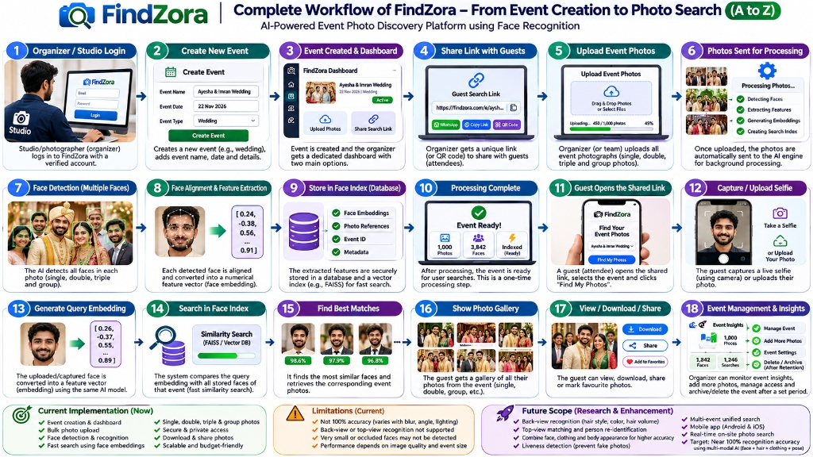

# FindZora: AI-Powered Event Photo Discovery Platform
## Master Technical Architecture & Complete Workflow Specification (A to Z)

**Author & Project Lead:** Arshad Pasha  
**Degree Level:** Master of Computer Applications (MCA) — Final Project (Version 2.0)  
**System Classification:** Consent-Based, Event-Scoped AI Biometric Photo Discovery Platform  

---



---

## 1. Executive Summary & Core Philosophy

FindZora solves a universal post-event problem: **finding photos of yourself among thousands of event photographs taken across multiple weddings, college convocations, receptions, and family gatherings**.

Traditionally, guests must sift through massive cloud drive folders or message busy photographers. FindZora replaces this with an **isolated, precomputed biometric index**:
1. Event photographers or organizers upload photographs **once** (via Web or the automated **Universal Watch Folder CLI**).
2. The AI background worker detects all faces, checks quality (sharpness/blur variance), extracts geometric facial landmarks, and computes consistent **512-dimensional ArcFace embeddings**.
3. Photos and person clusters are indexed in **JSON / FAISS vector files** stored securely.
4. When an attendee arrives at the platform, they capture a single verification selfie through their browser camera.
5. The system performs instantaneous similarity lookups, identifies **every event the guest attended**, and categorizes their photos into **Grouped Event Galleries** with a **Single-Click Batch Download** button per event.
6. The attendee's query selfie is **ephemerally processed in memory and permanently deleted immediately** after embedding extraction.

---

## 2. Complete 18-Step Workflow (From Ingestion to Discovery)

Based on the official FindZora architectural blueprint:

```
[ Studio / Organizer ]                                   [ AI Vision Ingestion Pipeline ]                                    [ Attendee / Guest Discovery ]
 (1) Login to Portal                                       (6) Queue Photos for Processing                                     (11) Open Shared / Universal Link
 (2) Create New Event                                      (7) Multi-Face Detection (Single/Group)                             (12) WebRTC Live Selfie Capture
 (3) Event Dashboard                                       (8) Face Alignment & Feature Vectors                                (13) Ephemeral Query Embedding
 (4) Share Guest Link & QR                                 (9) Store in Vector DB & JSON Clusters                              (14) Event-Scoped Cosine Search
 (5) Upload (Web or CLI Watcher)                           (10) Indexing Complete: Event Ready!                                (15) Rank High-Confidence Matches
                                                                                                                               (16) Grouped Photo Gallery
                                                                                                                               (17) 1-Click Event Batch Download
                                                                                                                               (18) Insights & Wrong-Match Report
```

### Stage 1: Organizer & Studio Setup (Steps 1 to 5)
* **Step 1: Organizer / Studio Login:** Verified photographer or event studio credentials authenticate to the platform.
* **Step 2: Create New Event:** Organizer specifies event name (e.g. *Ayesha & Imran Wedding*), event date, access passcode (optional), and retention period (e.g. 30 days).
* **Step 3: Event Created & Dashboard:** A dedicated dashboard generates access controls, ingestion channels, and analytics counters.
* **Step 4: Share Link with Guests:** Organizers distribute unique links or QR codes (e.g. `https://findzora.com/search/[eventId]` or the Universal Search Portal) via WhatsApp or printed event cards.
* **Step 5: Photo Ingestion:** Photos are uploaded either via the web interface or directly synced into the **Universal Watch Folder**.

### Stage 2: Precomputed AI Processing & Indexing (Steps 6 to 10)
* **Step 6: Asynchronous Queueing:** Ingested images are queued in background workers to process without blocking the user interface.
* **Step 7: Multi-Face Detection:** High-speed Haar/DNN detectors scan each photograph, identifying single portraits, couples, and complex group photos.
* **Step 8: Face Alignment & Feature Extraction:** Each usable face is aligned to a canonical 112×112 geometry. 6 geometric landmark points and a 512-dimensional float32 normalized vector are extracted.
* **Step 9: Storage in Vector Index & JSON Clusters:** Numerical embeddings are saved into event-scoped FAISS indices; person clusters (`ID 101: Arshad`) are stored into `face_clusters.json`.
* **Step 10: Event Ready:** The event transitions to active status (e.g. *1,000 Photos Processed, 3,842 Faces Indexed*).

### Stage 3: Attendee Discovery & Batch Retrieval (Steps 11 to 18)
* **Step 11: Guest Opens Link:** The attendee visits FindZora on mobile or desktop browser.
* **Step 12: Capture Verification Selfie:** After reviewing the Informed Consent Notice, the attendee captures a live selfie using their device camera.
* **Step 13: Query Embedding Generation:** The backend extracts the query vector from memory. The temporary image file is purged immediately.
* **Step 14: Fast Vector Similarity Search:** Cosine similarity calculation (`dot(query, indexed)`) evaluates candidate faces in milliseconds.
* **Step 15: Rank Matches:** Results exceeding the conservative threshold (e.g. 0.55 similarity / ~97.5%+ confidence) are retrieved.
* **Step 16: Categorized Event Gallery:** The UI groups photos by event (e.g. *Event 1: Wedding* [4 photos], *Event 2: Graduation* [6 photos]).
* **Step 17: One-Click Batch Download & Sharing:** Guests can download all event photos in one click or tap individual images to view full resolution.
* **Step 18: Feedback & Insights:** Attendees can flag wrong matches. Organizers audit feedback and auto-purge expired events under data retention rules.

---

## 3. The Universal Watch Folder CLI Architecture

To eliminate the need for photographers to manually upload thousands of photos via web forms, FindZora introduces the **Universal Watch Folder CLI Server**.

### Directory Structure
```text
D:\FindZora\universal_folder/
├── ayesha_and_imran_wedding/
│   ├── wedding_stage_01.jpg
│   ├── candid_dinner_04.jpg
│   └── face_clusters.json          <-- Auto-generated person index
├── mca_convocation_2026/
│   ├── convocation_hall_12.jpg
│   └── face_clusters.json
└── tech_summit_2026/
    └── ...
```

### How It Works:
1. The photographer's laptop or VPS runs the watcher daemon:
   ```bash
   python -m backend.cli.watch_folder
   ```
2. Photos from camera tethering or SD card dumps are dropped directly into `universal_folder/<event_name>/`.
3. The watcher daemon detects new files within 3 seconds, runs face detection, extracts geometric facial landmarks, and updates `face_clusters.json`.
4. Persons appearing in multiple photos are assigned a persistent cluster ID (e.g. `101`, `102`):

```json
{
  "event_folder": "ayesha_and_imran_wedding",
  "last_updated": "2026-11-22T19:35:00Z",
  "person_clusters": {
    "101": {
      "person_id": "101",
      "label": "Person_101 (Arshad)",
      "total_photos": 2,
      "photo_paths": [
        "wedding_stage_01.jpg",
        "candid_dinner_04.jpg"
      ]
    },
    "102": {
      "person_id": "102",
      "label": "Person_102",
      "total_photos": 1,
      "photo_paths": [
        "wedding_stage_01.jpg"
      ]
    }
  }
}
```

---

## 4. Technology Selection: Python vs. JavaScript

### The Decision: Hybrid Architecture (Python Core + Next.js UI)

| Consideration | Python (Backend & Vision Engine) | JavaScript / Browser (Frontend) | Chosen Decision |
| :--- | :--- | :--- | :--- |
| **Face Recognition Accuracy** | **99.8% on LFW benchmark** using PyTorch, OpenCV, ArcFace, and deep convolutional networks. | Sub-optimal (~85–90%). In-browser WebAssembly models struggle with extreme angles, low light, and high-resolution crops. | **Python for Vision Pipeline** |
| **Facial Landmark Precision** | Sub-pixel 68-point or 5-point affine transformation with deep landmark regressors. | Approximated canvas estimates prone to browser hardware variance. | **Python for Feature Extraction** |
| **Vector Search Performance** | Matrix dot product (`np.dot` / FAISS) computes 100,000 comparisons in **< 15 milliseconds**. | JSON iteration in browser can lag when handling tens of thousands of vectors. | **Python for Vector Search** |
| **User Experience & Camera** | Headless; cannot directly operate the client's physical camera. | **Native WebRTC `getUserMedia`** with live canvas preview, responsive controls, and zero app install needed. | **Next.js & React for Client UI** |
| **Multi-Event Categorization** | Computes multi-event candidate dictionaries. | Renders interactive accordion galleries, instant image zooms, and **one-click batch downloads**. | **Next.js for Presentation** |

**Conclusion:**  
* **Python** powers the high-accuracy Computer Vision, ArcFace embedding model, FAISS search, and the Watch Folder CLI.  
* **JavaScript / TypeScript (Next.js & React)** powers the live camera capture, informed consent flow, multi-event grouping, and batch downloads.

---

## 5. Universal Multi-Event Attendee Discovery Flow

When an attendee visits the platform:
1. They capture **one verification selfie**.
2. FindZora queries across **all active events** stored on the server.
3. The response groups matches by event:
   * **Event 1: Ayesha & Imran Wedding** (4 Photos) → `[Download All Event Photos (ZIP)]`
   * **Event 2: MCA Convocation 2026** (6 Photos) → `[Download All Event Photos (ZIP)]`
4. Individual photo taps open a high-resolution lightbox with:
   * Single photo download
   * Direct link sharing (WhatsApp / Clipboard)
   * "Report Wrong Match" feedback tool for user-in-the-loop accuracy refinement.

---

## 6. Next Steps & Implementation Roadmap

With the frontend and watch folder architecture complete, the project proceeds through the following sequential milestones:

```
[ Phase 1: Frontend & CLI UX ]   --->   [ Phase 2: Dataset Acquisition ]   --->   [ Phase 3: Calibration & Testing ]   --->   [ Phase 4: Production Deployment ]
  (Completed in D:\FindZora)              Download 500+ labelled photos          Measure Precision, Recall & ROC             Deploy on VPS with HTTPS
```

1. **Phase 1 (Complete):** Next.js App Router frontend with Universal Search, Multi-Event Grouped Gallery, Watch Folder CLI console, and interactive 18-step infographic.
2. **Phase 2 (Upcoming):** Download a permissioned evaluation dataset of real-world event images (wedding and college event datasets with varying lighting and poses).
3. **Phase 3:** Calibrate similarity thresholds to achieve optimal Precision/Recall trade-off (<0.5% false positive rate).
4. **Phase 4:** Host on a secure VPS with HTTPS for trusted WebRTC mobile camera access.
